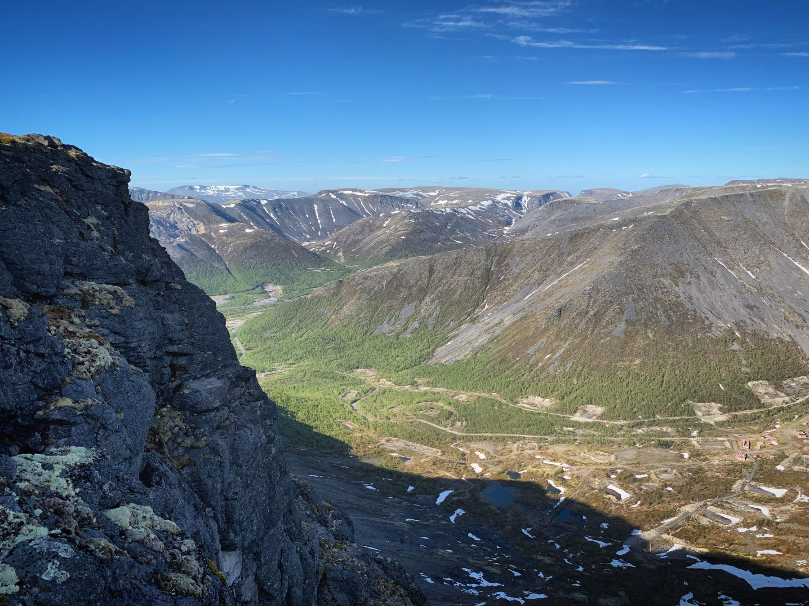

# Северная точка

Экспедиционное бюро · самостоятельный сайт для портфолио.



## Что можно сделать

- Сравнить пешие маршруты по России.
- Собрать поездку и рассчитать её ориентировочную стоимость.
- Отмечать снаряжение в списке и скачать план маршрута.

## Запуск

Откройте `index.html` в браузере. Для локального сервера:

```sh
python3 -m http.server 8000
```

Затем перейдите на `http://127.0.0.1:8000/`. Сборка и установка пакетов не нужны.

## Устройство проекта

- `index.html` — страница сайта;
- `app.js` — интерактивные сценарии;
- `style.css` или `styles.css` — оформление;
- `assets/` — фотографии, сохранённые в проекте;
- [CREDITS.md](CREDITS.md) — авторы и источники фотографий.

Бренд, тексты, цены и адреса вымышлены. Это статический фронтенд: действия посетителя демонстрируются в браузере, без реального заказа, оплаты или бронирования. Сервер и сторонние API для основных сценариев не требуются.

Исходный код представлен как работа портфолио; отдельная лицензия на него не задана. Права на фотографии и условия их использования указаны в [CREDITS.md](CREDITS.md).
